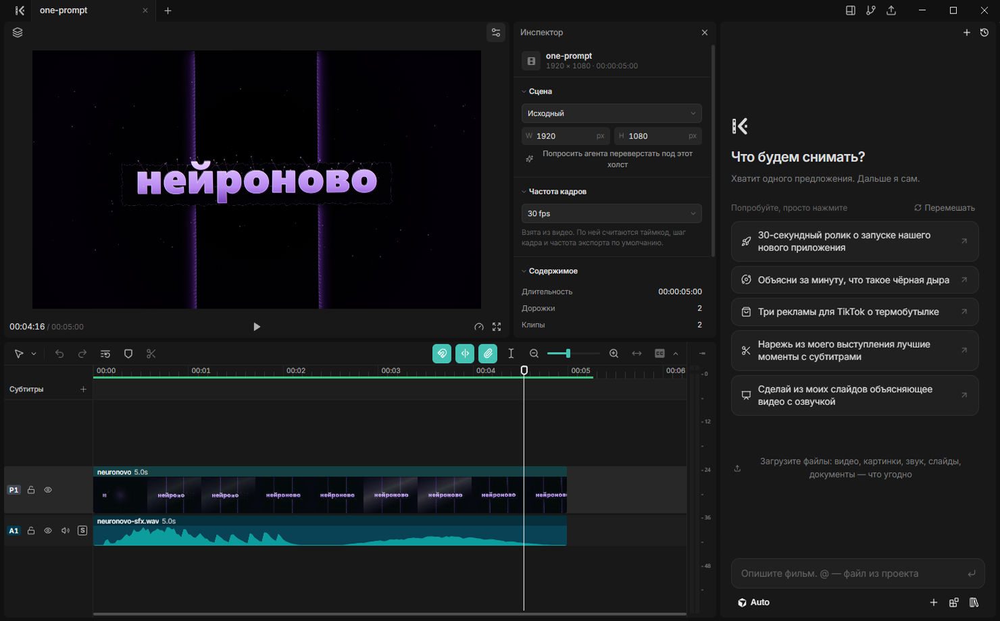

<p align="center">
  <br>
  
  
</p>

<h3 align="center">ИИ-агент для видео с открытым кодом.</h3>

<p align="center">Один HTML-файл, одна функция, настоящий монтажный редактор.</p>

<p align="center"><a href="https://нейроново.рф">нейроново.рф</a></p>

<p align="center"></p>

## Что это

КиноКод даёт вашему агенту для кода снимать видео, а вам — монтировать их.

Попросите Codex, Claude Code или другого агента сделать ролик. Он пишет фильм как набор веб-страниц, а Studio —
локальный редактор в браузере — показывает, как ролик собирается. Дальше меняйте что угодно: руками или словами.

- **Один HTML-файл.** `film.html` собирает на дорожках анимированные страницы, видео, картинки и звук, оформленные
  через CSS. Учить ничего не надо: веб ваш агент уже знает.
- **Одна функция.** Каждый кадр — веб-страница, которая рисует любой момент через `frame(t)` чем угодно, что умеет
  браузер: three.js, WebGL, canvas, SVG, CSS, GSAP, видео. Никаких фреймворков: хватает одной функции.
- **Настоящий редактор.** Двигайте, масштабируйте и вращайте любой элемент на странице, меняйте текст, цвет и стиль;
  ставьте, кадрируйте и режьте клипы на таймлайне.

## Установка

Скачайте установщик для Windows (`kinocode-Setup-x64.exe`) из
[Releases](https://github.com/neuronovo-X/kinocode/releases). Это Studio с чатом для агентов, которые у вас есть.
ffmpeg и браузер для отрисовки уже внутри, ставить больше ничего не нужно.

Установщик не подписан, поэтому Windows покажет SmartScreen: «Подробнее» → «Выполнить в любом случае».

Аккаунт не нужен ни для создания, ни для монтажа, ни для рендера. Для озвучки, музыки, картинок и видео
подключите свои сервисы (ElevenLabs, OpenAI, Google, fal и другие) своими ключами: Studio → Настройки → Провайдеры.

Потом попросите агента:

> Сделай 20-секундный ролик о запуске моей CLI-утилиты, с музыкой.

## Команды

Их запускает агент, но можно и самому.

```sh
kinocode                          # руководство: всё, что нужно знать агенту
kinocode open   [папка | url]     # открыть фильм в Studio: новый, существующий, с GitHub, иначе этот или последний
kinocode look   [что] [t | a-b]   # проверить фильм, страницу или медиафайл: лист кадров, один кадр или отрезок
kinocode render [a-b]             # MP4; --4k, --blur (размытие в движении), --alpha (.webm / .mov)
kinocode get    [что]             # озвучка, музыка, звуки, расшифровки, картинки, видео — из ваших сервисов
kinocode doctor                   # что есть на этом компьютере для КиноКода, чтобы приложить к отчёту об ошибке
```

`kinocode <команда> --help` покажет параметры команды.

## Studio

Studio работает у вас на компьютере, в браузере на Chromium (Chrome, Edge): на этом же движке фильмы рисуются и
экспортируются, поэтому превью совпадает с результатом. Менять можно всё: текст и слои в кадре, клипы на таймлайне,
их место, вид, громкость и скорость, субтитры. Правки сохраняются в файлы фильма, так что агент их видит и не
теряет, а именованные версии позволяют вернуться назад. Экспорт: видео, GIF, звук целиком или по дорожкам, субтитры,
кадры, слайды, видео с прозрачностью или сам таймлайн для Final Cut Pro, Premiere Pro и DaVinci Resolve.

Десктоп-приложение ([apps/desktop](apps/desktop)) — это Studio с чатом рядом: для Claude Code, Codex и других
агентов или для встроенного агента с вашим ключом.

## Как это устроено

Фильм — это папка с `film.html`: дорожки с клипами.

```html
<meta name="viewport" content="width=1920, height=1080">
<style>
  .card { object-fit: cover; border-radius: 24px; }
</style>
<section>
  <iframe src="title.html#t=0,4"></iframe>
</section>
<section>
  <video src="assets/footage.mp4#t=12,18" at="4" speed="0.5" class="card" style="left: 160px; top: 90px; width: 1600px; height: 700px"></video>
</section>
<section>
  <audio src="assets/music.mp3" volume="0.6"></audio>
</section>
```

Каждая `<section>` — дорожка, в том порядке, в каком их показывает таймлайн: первая сверху. Клип — это элемент:
страница, видео, картинка или звук. Какая часть файла играет, задаёт медиафрагмент (`#t=12,18`), когда клип
начинается — `at`, где он стоит — `left`, `top`, `width` и `height` в стиле, а как выглядит — CSS. Каждый звук —
отдельный клип. В `overrides` хранятся ваши правки элементов страницы, и агент сохраняет их при своих изменениях.

Страница — это веб-страница, которая умеет нарисовать любой свой момент. Вот и весь контракт:

```html
<script type="module">
window.film = {
  frame(t) { /* нарисовать полный кадр на t секунд, чем угодно */ },
  duration: 4,               // необязательно: своя длина в секундах
  ready: loadFonts(),        // необязательно: Promise для шрифтов, картинок, моделей, данных
  width: 480, height: 320,   // необязательно: страница, которая занимает только часть кадра
};
</script>
```

**Единственное правило:** одно и то же `t` всегда даёт один и тот же кадр, что бы ни рисовалось до этого. Кадры
запрашиваются вразнобой, параллельно и между кадрами (для размытия в движении), поэтому страница, которая держит
правило, рендерится одинаково в любом размере и на любой машине. Всё остальное, что делает картинки (Python,
Blender, видеомодели), приходит как видео или изображения.

Главное усилие КиноКод тратит там, где модели ошибаются, — на проверку фильма. `look` рисует каждый кадр листа
дважды, в двух случайных порядках, и называет те, что изменились, а ещё ошибки страниц, незагрузившиеся шрифты,
пропавшие звуки и текст, обрезанный краем кадра.

[MANUAL.md](packages/openfilm/MANUAL.md) — то, что команда рассказывает агенту; [SPEC.md](packages/openfilm/SPEC.md)
— для тех, кто делает плеер, рендерер или редактор.

## Сборка из исходников

Нужны Node 22.18 или новее, pnpm 9 (`corepack enable` даст версию, указанную в репозитории), ffmpeg в PATH и git.

```sh
git clone https://github.com/neuronovo-X/kinocode && cd kinocode
pnpm install
pnpm dev            # Studio из этой копии, с примером фильма
pnpm test
```

`pnpm dev:desktop` запускает десктоп-приложение из исходников, `pnpm typecheck` и `pnpm build` делают то, что
написано. Установщик для Windows: `pnpm --filter @openfilm/desktop release --platform=win --arch=x64`.

## Обратная связь

Ошибки и идеи — в [Issues](https://github.com/neuronovo-X/kinocode/issues). Приложите отчёт из настроек Studio
(раздел для разработчиков) или вывод `kinocode doctor`.

## Лицензия

MIT: см. [LICENSE](LICENSE) и [THIRD_PARTY_NOTICES.md](THIRD_PARTY_NOTICES.md).
